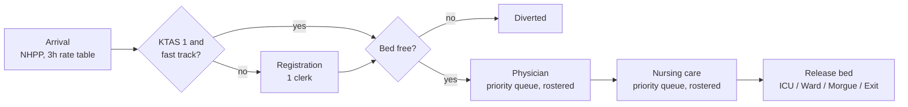
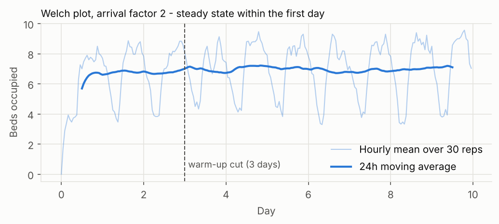
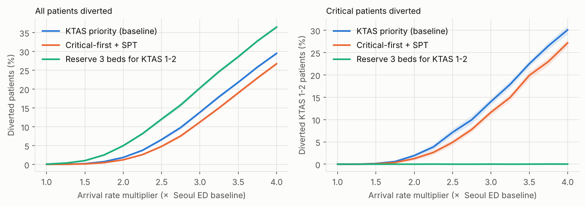

# Emergency Department Surge Simulation

A discrete-event simulation of a Seoul emergency department (ED), built to answer one question:
**when demand surges, what keeps critical patients from being turned away, and what is the cheapest
way to get there?**

The model started as a Simio team project (Yonsei IIE3110 Simulation, Fall 2025). This repository
re-implements it in Python/SimPy, validates it against queueing theory, and extends the analysis
with paired policy comparisons, a surge stress test and a simulation-optimization study.

| | |
|---|---|
| Engine | SimPy 4, NumPy; output analysis with SciPy |
| Validated against | Erlang C (M/M/c) waiting time and utilization |
| Experimental design | 3-day warm-up (Welch), 30 replications, common random numbers, paired-t CIs |
| Main finding | Changing *queue order* reduces diversion by about as much as adding beds, at zero cost; the price is longer waits for KTAS 3 |

## Model



A patient holds the bed from allocation until nursing care ends. Physicians and nurses follow
3-hour rosters; staff going off duty finish their current patient first.

### Inputs

| Input | Value | Source |
|---|---|---|
| Arrival rate by 3h block (patients/h) | 1.00, 0.65, 0.86, 1.74, 1.65, 1.68, 1.77, 1.40 | e+MEDIS Seoul 2016-2024 |
| KTAS 1-5 mix | 1.1%, 6.3%, 40.0%, 41.5%, 11.1% | e+MEDIS |
| Physician / nursing time | Triangular, by KTAS (e.g. KTAS 3: 0.3-0.5-1.0 h / 1.5-2.5-4 h) | team Simio model |
| Disposition (ICU/Ward/Morgue/Exit) | by KTAS | e+MEDIS |
| Beds | 15 (5,918 beds / 409 Seoul EDs) | e+MEDIS 2024 |
| Physicians on duty | 2-3 by shift | **assumed**, sized from 6.8 EM specialists per ED |
| Nurses on duty | 6-9 by shift | **assumed**, sized from 35.1 nurses per ED |
| Registration | 1 clerk, Triangular(3, 5, 10) min | **assumed** |

Every value is in [`er_sim/params.py`](er_sim/params.py), with assumptions marked. The original Simio
rosters and registration times were not recoverable, so those three rows are documented estimates.

## Validation

The simulator is reduced to an M/M/c queue (Poisson arrivals, exponential service, unlimited beds,
one patient class) and compared with the closed-form Erlang C result
([`tests/test_validation.py`](tests/test_validation.py)):

| λ (/h) | mean service (h) | c | ρ | Wq Erlang C (min) | Wq simulated (min, 95% CI) |
|---:|---:|---:|---:|---:|---:|
| 4.0 | 0.5 | 3 | 0.67 | 13.33 | 13.25 ± 0.51 |
| 6.0 | 0.4 | 3 | 0.80 | 25.89 | 26.21 ± 1.15 |
| 2.0 | 0.8 | 2 | 0.80 | 85.33 | 87.79 ± 5.26 |

The tests also check the NHPP arrival count, the triangular inverse CDF, that common random numbers
reproduce identical patients across policies, and that reserved beds actually protect KTAS 1-2.

## Experimental design

- **Run length**: 30 days measured after a 3-day warm-up; arrivals then stop and the system drains so
  every measured patient is completed (no right-censoring of length of stay).
- **Warm-up**: the Welch plot shows bed occupancy reaching steady state within the first day, so the
  3-day cut is conservative.
  
- **Replications**: 30. At ×3 demand this gives a door-to-doctor CI half-width of about 2% of the mean
  and a diversion half-width of 0.5%p ([`results/replications.csv`](results/replications.csv)).
  The original Simio experiment used 10.
- **Common random numbers**: replication *r* uses the same seed in every configuration, and each
  patient consumes a fixed block of five uniforms. Policies are compared on identical patient streams
  using paired differences, which gives much tighter CIs than independent runs.

## Results

### 1. Scenarios

[`results/scenarios.md`](results/scenarios.md) - mean ± 95% CI, 30 replications.

| Scenario | Diversion | Diversion KTAS 1-2 | Door-to-doctor (min) | DTD p90 (min) | Bed util. |
|---|---|---|---|---|---|
| Normal | 0.0% | 0.0% | 7.3 ± 0.1 | 10.1 | 22% |
| HighDemand ×2 | 1.8% ± 0.2% | 1.9% ± 0.4% | 12.1 ± 0.3 | 23.5 | 47% |
| ExtremeDemand ×3 | 13.8% ± 0.4% | 14.0% ± 0.7% | 18.2 ± 0.4 | 39.8 | 71% |
| ×2, beds +10% (17) | 1.0% ± 0.2% | 1.1% ± 0.3% | 12.6 ± 0.3 | 24.5 | 42% |
| ×2, 20% beds reserved for KTAS 1-2 | 5.0% ± 0.3% | **0.0%** | 11.0 ± 0.2 | 21.1 | 44% |

Average bed utilization badly understates risk. At ×2 the beds are only 47% busy on average, yet
patients are already being diverted, because evening peaks run at nearly twice the overnight rate.

### 2. Policies (paired, common random numbers)

[`results/policies.md`](results/policies.md). Difference vs. the baseline (KTAS-priority queues),
×3 demand:

| Alternative | Δ diversion | Δ diversion KTAS 1-2 | Δ DTD KTAS 1-2 | Δ DTD KTAS 3 |
|---|---|---|---|---|
| Beds +2 (17) | −2.00 ± 0.14 %p | −1.41 ± 0.72 %p | +0.28 min | +0.72 min |
| **Critical-first + SPT** | **−2.60 ± 0.14 %p** | **−2.40 ± 0.74 %p** | n.s. | **+7.15 min** |
| FCFS | −1.95 ± 0.11 %p | −1.41 ± 0.86 %p | +4.64 min | +2.86 min |
| Reserve 3 beds for KTAS 1-2 | +6.45 ± 0.15 %p | −14.01 ± 0.73 %p | n.s. | −1.52 min |
| No fast track | n.s. | n.s. | +1.36 min | n.s. |

Why pure KTAS priority is not the best policy: KTAS 1-3 patients also have the longest treatment
times, so "sickest first" is close to *longest job first*. Every patient waiting in a queue is also
holding a bed, and serving long jobs first maximizes the number of occupied beds, which is the
mirror image of the shortest-processing-time (SPT) result from single-machine scheduling.
**Critical-first + SPT** keeps KTAS 1-2 at the front and orders KTAS 3-5 by expected treatment time.
At ×3 it beats adding two beds on diversion, for free (at ×2 the two are roughly level), and the cost
shows up explicitly as longer waits for KTAS 3.

Reserving beds is the only policy that protects critical patients almost completely (KTAS 1-2
diversion drops from 14% to ~0%), but it diverts more patients overall.

### 3. Surge stress test



Under the baseline policy, diversion passes 5% at ×2.5 demand. Reserved beds keep KTAS 1-2 diversion
flat across the whole range, at the cost of the highest overall diversion.

### 4. Simulation optimization

[`experiments/05_optimize.py`](experiments/05_optimize.py) searches 288 configurations (beds 15-32,
+0-3 nurses and +0-1 physicians per shift, two queue policies) for the cheapest plan that survives a ×3
surge with every constraint met at the **95% CI upper bound**:

- total diversion ≤ 2%
- KTAS 1-2 diversion ≤ 1%
- KTAS 3 door-to-doctor ≤ 30 min (the KTAS target)

The search is two-stage: every configuration is screened with 8 replications, then the cheapest
candidates per policy are confirmed with 50.

| Policy | Beds | +Nurses | +Physicians | Cost/day* | Diversion (UB) | KTAS 1-2 div. (UB) | DTD KTAS 3 |
|---|---:|---:|---:|---:|---:|---:|---:|
| KTAS priority | 31 | 2 | 0 | ₩9.67M | 0.90% | 0.97% | 19.2 min |
| Critical-first + SPT | 22 | 2 | 1 | ₩11.02M | 0.87% | 0.86% | 12.5 min |

\*Illustrative costs (bed ₩250k/day, nurse ₩40k/h, physician ₩150k/h), not hospital data.

No plan that only adds beds is feasible: at ×3 the nursing stage is the bottleneck (86% utilization),
and nurse queues hold beds. Once the KTAS 3 waiting limit is enforced, the SPT policy needs an extra
physician, which costs more than the nine extra beds it saves. So the scheduling rule that wins in
the unconstrained comparison (section 2) loses once the clinical constraint is enforced. Which plan
is cheaper depends on the cost ratios, which are inputs here.

### 5. Sensitivity to the assumed inputs

[`results/sensitivity.md`](results/sensitivity.md), ×3 demand, paired:

| Variant | Baseline diversion | Nurse util. | Physician util. | Δ diversion, SPT − priority | Δ DTD KTAS 3 |
|---|---:|---:|---:|---:|---:|
| as assumed | 13.8% | 86% | 67% | −2.60 ± 0.14 %p | +7.1 min |
| nurses −1 per shift | 19.1% | 93% | 63% | −3.10 ± 0.17 %p | +5.1 min |
| nurses +2 per shift | 10.1% | 72% | 70% | −1.84 ± 0.12 %p | +9.3 min |
| physicians −1 per shift | 26.7% | 73% | 95% | −2.84 ± 0.25 %p | **+162.7 min** |
| physicians +1 per shift | 12.6% | 87% | 48% | −2.10 ± 0.13 %p | +0.6 min |
| registration ×2 slower | 11.7% | 88% | 68% | −3.32 ± 0.13 %p | +7.6 min |
| 2 clerks | 14.1% | 86% | 67% | −2.63 ± 0.14 %p | +7.6 min |

The diversion advantage of critical-first + SPT is significant in every variant. Its cost depends
entirely on physician capacity: negligible with one extra physician per shift, but if physicians are
the bottleneck, KTAS 3 patients wait almost three hours longer. That is why the optimizer pairs SPT with an extra
physician. One side effect: slower registration *lowers* diversion, because the desk throttles the
peak inflow into beds.

## Run it

```bash
pip install -r requirements.txt
pytest                                   # validation, ~20 s
cd experiments
python 01_warmup_and_reps.py             # Welch plot, replication count
python 02_scenarios.py                   # scenario table
python 03_policies.py                    # paired policy comparison
python 04_surge_curve.py                 # stress test (~1 min)
python 05_optimize.py                    # simulation optimization (~3 min on 2 cores)
python 06_sensitivity.py                 # robustness to assumed inputs (~1 min)
```

```
er_sim/
  params.py       inputs and Config (all assumptions marked)
  model.py        SimPy model, rostered staff, KPIs
  experiment.py   replications, CIs, paired differences
experiments/      one script per analysis, writes to results/
tests/            validation against closed-form results
results/          generated tables and figures
```

## Limitations

- Physician/nurse rosters and registration time are assumptions (see Inputs). The sensitivity check
  below varies them; the numbers move but the conclusions do not.
- Not yet calibrated against the e+MEDIS length-of-stay distribution; that is the next validation step.
- Diverted patients leave immediately; there is no waiting room and no reneging.
- Treatment times are independent of congestion.
- The optimization is a grid search with two-stage screening, not a ranking-and-selection procedure
  with a formal probability of correct selection.

## Credits

Original Simio model and data collection: Yonsei University IIE3110 (Simulation, Fall 2025), Team 5. Data: National Emergency Medical Center e+MEDIS (Seoul, 2016-2024).
